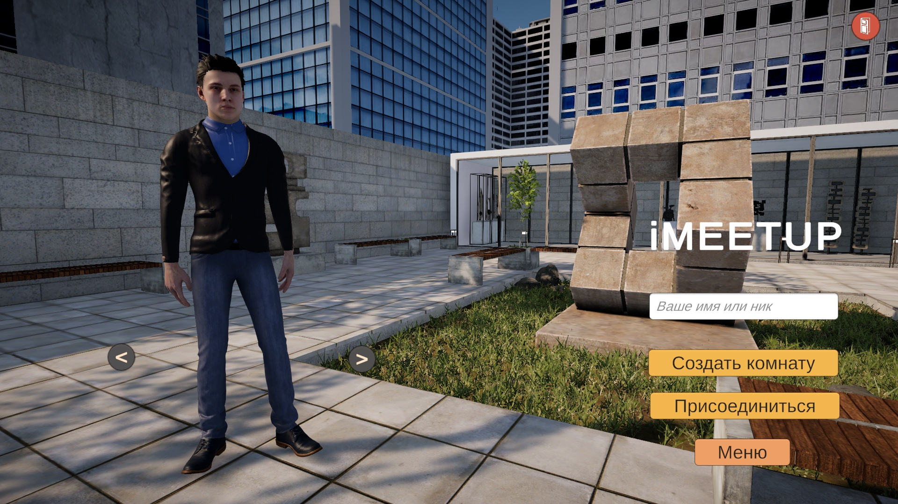
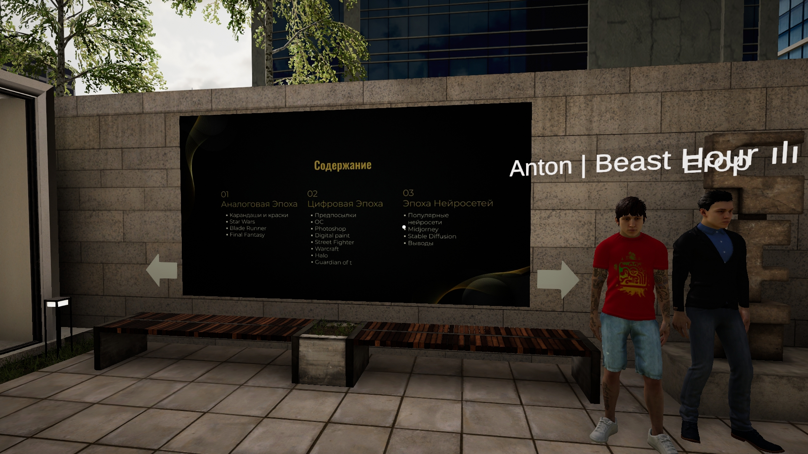
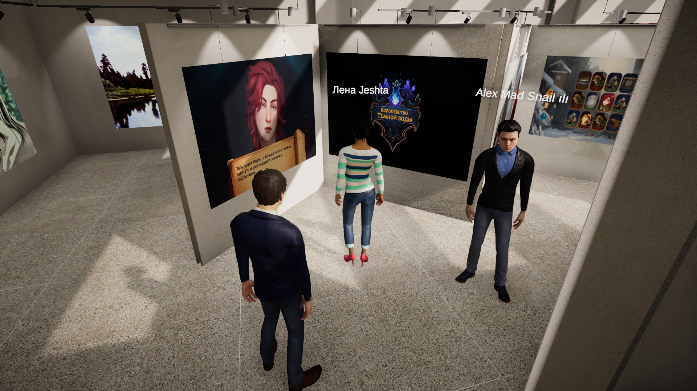

# Description

A prototype of a platform for virtual events that I developed for the [iMeetup](https://vk.ru/imeetup) project
- Development began in the summer of 2023
- Work was discontinued by the end of the year due to a lack of funding from the clients
- Supports the creation of online rooms with built-in text and voice chats
- Unfortunately, the build no longer works because it uses an outdated version of Alteruna

# Key responsibilities

- Integration of [Alteruna](https://assetstore.unity.com/packages/package/217234), [Agora](https://www.agora.io), and [Five Minute Chat](https://assetstore.unity.com/packages/tools/network/five-minute-chat-192443) for collaborative functionality
- UI prototyping
- Development of user documentation for the client

# What I would change

Since I was a junior developer at the time, the project lacks architectural maturity. 
Many scripts would benefit from being broken down into smaller components to adhere to the Single Responsibility Principle. 
I would also improve the client's workflow by developing tools to make editing assets, such as models and locations, more convenient.
And also add localization support

# Screenshots
The screenshots are taken from the release version. The only differences are the models and a slightly modified UI   

